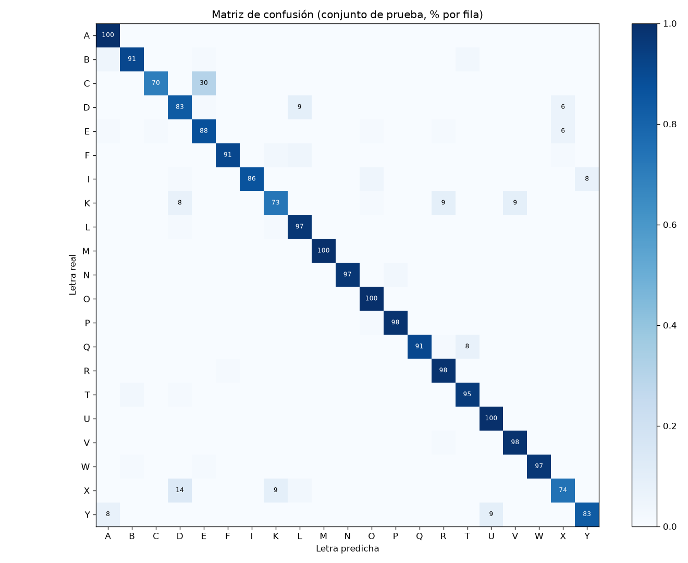

# Señas LSC: reconocimiento del abecedario de la Lengua de Señas Colombiana

MVP del curso **Programación Avanzada**. La app usa la cámara del computador
para reconocer letras del abecedario de la Lengua de Señas Colombiana (LSC) y
las va escribiendo en pantalla. La tecnología central es **Keras 3**.



## 1. Problema que resuelve

En Colombia la mayoría de oyentes no conoce la LSC, y eso aísla a las personas
sordas en trámites, aulas y servicios. Este MVP no traduce la lengua completa
(que tiene gramática, expresión facial y movimiento). Su alcance es más
pequeño: reconocer el **deletreo manual** (dactilología) de letras estáticas.
Así se muestra que un modelo ligero, que corre en un computador común sin
GPU ni nube, puede servir de base para herramientas de aprendizaje de la LSC
o de apoyo en la comunicación.

**Alcance actual:** 21 letras estáticas: A B C D E F I K L M N O P Q R T U V W X Y.
Las letras G, H, J, Ñ, S y Z se hacen con movimiento y quedan fuera
(ver [sección 5](#5-decisiones-de-diseño-por-qué-y-para-qué)).

## 2. Arquitectura

```
┌──────────────────────── Navegador (tu computador) ────────────────────────┐
│  Cámara ──► MediaPipe Hands (JavaScript) ──► 21 puntos (x, y, z)           │
│                │                                     │                     │
│                ▼                                     ▼  63 números          │
│      dibuja la mano sobre el video          POST /predecir (JSON)          │
│                                                      │                     │
│  Letra grande + % confianza ◄── {letra, confianza} ◄─┤                     │
│  Palabra (se agrega si se mantiene 1 s)              │                     │
└──────────────────────────────────────────────────────┼─────────────────────┘
                                                       ▼
┌──────────────── Servidor FastAPI (127.0.0.1:8000, mismo computador) ───────┐
│  normalizar_puntos() ──► red Keras (Dense) ──► softmax de 21 letras        │
│  si confianza < 70 % ──► "No estoy seguro"                                 │
└────────────────────────────────────────────────────────────────────────────┘
```

- **El video nunca sale del navegador.** Al servidor solo llegan 63 números
  por consulta (21 puntos × 3 coordenadas), y el servidor solo escucha en
  `127.0.0.1`: nadie más en la red puede conectarse.
- **El modelo aprende puntos de la mano, no fotos.** Por eso no depende del
  fondo, la luz ni la ropa, y pesa 70 KB (17.813 parámetros).
- **La normalización está en un solo lugar** (`comun.py`), que usan la
  extracción, la grabación de datos propios y la API. El navegador envía los
  puntos en píxeles y el servidor los normaliza, así no hay una segunda copia
  en JavaScript que pueda diferir.

### Archivos

| Archivo | Etapa | Qué hace |
|---|---|---|
| `requirements.txt` | 1 | Librerías con versiones probadas en Windows |
| `comun.py` | — | Normalización compartida y arreglo de rutas con tilde |
| `extraer_puntos.py` | 2 | Corre MediaPipe sobre LSC70ANH → `datos/puntos_lsc70.csv` |
| `grabar_mis_datos.py` | 3 | Graba ejemplos propios con la webcam → `datos/mis_datos.csv` |
| `entrenar.py` | 4 | Entrena la red y genera `modelo_senas.keras`, `etiquetas.json` y `resultados/` |
| `api.py` | 5 | Servidor FastAPI: `POST /predecir`, `GET /salud`, la página |
| `index.html` | 6 | Interfaz: cámara, mano dibujada, letra, confianza y palabra |
| `iniciar_windows.bat` | 7 | Arranque con doble clic |
| `LSC70/LSC70ANH/` | — | Imágenes del dataset (ver [cita](#10-dataset-y-cita)) |

## 3. Cómo ejecutarlo

### Uso rápido (el modelo ya viene entrenado en el repositorio)

1. Instala el entorno (una sola vez, ver abajo).
2. Doble clic en **`iniciar_windows.bat`**. Se abre `http://127.0.0.1:8000`
   en el navegador.
3. Permite el acceso a la cámara y haz una letra. Si la mantienes 1 segundo,
   se agrega a la palabra. Los botones **Espacio** y **Borrar** (o las teclas
   espacio y retroceso) editan la palabra.

### Instalación (Windows, Python 3.12)

Ejecuta estos comandos uno por uno en PowerShell, dentro de la carpeta del proyecto:

```bash
py -3.12 -m venv venv
```

```bash
venv\Scripts\pip install -r requirements.txt
```

```bash
venv\Scripts\pip install --no-deps mediapipe==0.10.21
```

`mediapipe` se instala aparte y con `--no-deps` por dos razones: la versión
1.x eliminó la API `mp.solutions.hands` que usamos, y su lista de
dependencias trae `jax`, que no usamos y que choca con TensorFlow 2.17.

> **Rutas con tilde (ej. `C:\Users\Andrés\...`).** MediaPipe es código
> compilado en C++ y no encuentra sus archivos de modelo si la ruta tiene
> caracteres no-ASCII. Los scripts lo resuelven solos (`comun.py` cambia las
> rutas por su versión corta de Windows, `C:\Users\ANDRS~1\...`) y el `.bat`
> también usa la ruta corta. No hace falta mover la carpeta.

### Reproducir todo desde cero

```bash
venv\Scripts\python extraer_puntos.py
```

```bash
venv\Scripts\python entrenar.py
```

La extracción tarda unos 8 minutos en CPU (11.340 fotos). El entrenamiento
tarda menos de un minuto. Con la semilla fija (`SEMILLA = 42`) da los mismos
resultados en cada corrida.

### Agregar ejemplos propios (opcional)

```bash
venv\Scripts\python grabar_mis_datos.py --nombre andres
```

El script pide escribir `acepto` (ver [sección 7](#7-ley-1581-de-2012-y-consentimiento)).
Luego haz una letra y presiona su tecla; si la mantienes presionada, graba
varias muestras. `Esc` para salir. Después vuelve a correr `entrenar.py`: los
datos propios se usan solo para entrenamiento, nunca para la prueba.

## 4. Resultados

Evaluados con **11 voluntarios que el modelo nunca vio** (1.384 muestras):

| Métrica | Valor |
|---|---|
| Exactitud en prueba | **91,0 %** |
| Exactitud con la mano reflejada (simula personas zurdas) | 90,5 % |
| Con umbral de 70 %: casos en que responde | 93,3 % |
| Con umbral de 70 %: aciertos cuando responde | **94,0 %** |
| Exactitud por persona (mín. / mediana / máx.) | 76 % / 91 % / 100 % |
| Tiempo por consulta a `/predecir` | ~6 ms |
| Detección de mano de MediaPipe en el dataset | 98,2 % de las fotos |

- **Mejores letras:** A, M, O, U (100 %), P, R, V (98 %).
- **Peores letras:** C (70 %, el 30 % la confunde con E: ambas tienen la mano
  curvada), K (73 %) y X (74 %, se confunde con D y K).

Detalles en `resultados/`: `metricas.json`, `reporte_por_letra.txt`,
`matriz_confusion.png` y `curvas_entrenamiento.png`.

## 5. Decisiones de diseño (por qué y para qué)

**Puntos de la mano en vez de fotos.** Con fotos, una red aprendería también
el fondo, la ropa y el tono de piel de los 70 voluntarios. Con los 21 puntos
de MediaPipe solo ve la forma de la mano. Además, el modelo pasa de millones
de parámetros a 17.813 y se entrena en segundos sin GPU.

**Normalización.** A cada punto se le resta la muñeca (así da igual dónde
esté la mano en la imagen) y se divide por la distancia muñeca → nudillo del
dedo medio (así da igual si la mano está cerca o lejos). Se usa la palma y no
la mano completa porque la palma mide lo mismo con el puño cerrado o abierto.
Antes de normalizar, las coordenadas se pasan a píxeles, porque la webcam es
4:3 y las fotos del dataset son 1:1 y la mano no debe deformarse.

**Preparación de las fotos.** Las fotos son de 120×120 y la mano casi llena el
recuadro. En una prueba con 400 fotos, ampliarlas ×2 y agregar un margen del
25 % subió la detección al 98,5 %. Solo ampliarlas la bajaba a 94,8 %.

**Letras estáticas, elegidas con datos.** Cada seña del dataset tiene 6
fotogramas. `entrenar.py` mide cuánto cambian los puntos entre ellos. Las 21
letras estáticas se mueven menos de 0,13 "tamaños de palma" y G, H, J, Ñ, S y
Z se mueven más de 0,38. Con un corte tan claro, un modelo que mira una sola
pose no puede reconocer esas seis; necesitarían un modelo de secuencias.

**División por voluntario (70 / 15 / 15 %).** Las 6 fotos de una seña son casi
idénticas. Si se repartieran fotos al azar, el modelo vería en la prueba casi
las mismas imágenes que en el entrenamiento y la exactitud saldría inflada
(fuga de datos). Por eso cada persona está en un solo grupo: 49 voluntarios
para entrenar, 10 para validar y 11 para la prueba. El script lo verifica
con `assert`.

**Aumento con espejo.** Cada ejemplo de entrenamiento se duplica reflejado
(se cambia el signo de las x). Así el modelo reconoce letras hechas con la
mano izquierda y no importa si la cámara muestra la imagen en espejo.

**Modelo.** `Input(63) → Dense(128, relu) → Dropout(0.3) → Dense(64, relu) →
Dense(21, softmax)`. Es una red Dense porque la entrada es un vector, no una
imagen. El Dropout apaga al azar el 30 % de las neuronas al entrenar para
reducir el sobreajuste. `EarlyStopping` detiene el entrenamiento cuando la
pérdida de validación deja de mejorar durante 15 épocas y recupera los
mejores pesos. `ModelCheckpoint` guarda en disco el mejor modelo.

**Umbral de 70 %.** Si la probabilidad más alta es menor al 70 %, la API
responde "No estoy seguro" en vez de inventar una letra. En la prueba, eso
deja sin respuesta el 6,7 % de los casos y sube los aciertos de 91 % a 94 %.

**"Mantener 1 segundo".** Evita que se escriban letras sueltas en las
transiciones entre una letra y otra. Para repetir una letra (ej. "LL") hay que
cambiar de pose o retirar la mano entre una y otra.

## 6. Costos de infraestructura

| Escenario | Costo |
|---|---|
| **Uso local (este MVP)** | **$0**: corre en el computador del usuario, sin GPU ni internet (salvo para descargar MediaPipe JS la primera vez desde el CDN jsDelivr). |
| Entrenamiento | $0: menos de 1 minuto en CPU. La extracción de puntos tarda ~8 minutos. |
| Publicarlo en internet | Bastaría un servidor virtual pequeño de CPU, de los planes más baratos de cualquier proveedor. El modelo pesa 70 KB y cada predicción tarda ~6 ms. El video no se procesa en el servidor, así que el ancho de banda es mínimo (unos cientos de bytes por consulta). Habría que sumar un dominio y HTTPS: la cámara solo funciona en `localhost` o con HTTPS. |
| Alternativa sin servidor | Convertir el modelo a TensorFlow.js y correrlo en el navegador: costo de servidor $0 y ningún dato sale del dispositivo. |

## 7. Ley 1581 de 2012 y consentimiento

La Ley 1581 de 2012 (Régimen General de Protección de Datos Personales)
exige autorización previa, expresa e informada para tratar datos personales.
Los datos biométricos, como las características de la mano, son **datos
sensibles** (art. 5) y tienen protección reforzada (art. 6).

Cómo lo aplica este proyecto:

- **Uso de la app:** el video se procesa en el navegador y no se guarda.
  Al servidor (en el mismo computador) solo llegan 63 números por consulta,
  que no se almacenan ni se registran.
- **Grabación de datos propios:** `grabar_mis_datos.py` muestra un aviso de
  autorización (qué se guarda, para qué y cómo pedir que se borre) y no
  graba nada si la persona no escribe `acepto`. Solo guarda números, no
  imágenes. Se identifica a la persona con un nombre o seudónimo.
- **Derecho a suprimir:** basta con borrar las filas de esa persona en
  `datos/mis_datos.csv` y volver a entrenar.
- **No se publican:** `datos/mis_datos.csv` está en `.gitignore`. Si se
  graban datos de compañeros, se recomienda además una autorización firmada
  y no grabar a menores de edad sin autorización de sus representantes.
- **Dataset LSC70:** se usa bajo licencia CC BY 4.0. Fue publicado por sus
  autores con los rostros difuminados.

## 8. Riesgos y limitaciones

**Errores del modelo**
- Falla aproximadamente 1 de cada 11 veces con personas nuevas, y más en C
  (se confunde con E), K y X. No sirve para situaciones críticas (salud,
  justicia) sin supervisión humana.
- No reconoce las 6 letras con movimiento ni palabras completas. La LSC real
  incluye gestos, expresión facial y movimiento.
- Las fotos del dataset se tomaron con celular. Con la webcam de un portátil
  (otro ángulo, otra distancia) la exactitud real puede ser menor que la
  medida. Grabar datos propios con `grabar_mis_datos.py` ayuda a cerrar esa
  brecha.

**Sesgo**
- **Entre personas:** la exactitud va del 76 % (Per01) al 100 % (Per55). El
  modelo funciona peor para algunas manos o formas de hacer las letras.
  Faltan datos para saber por qué (tamaño de mano, edad, variantes regionales
  de las señas).
- **Tono de piel:** el modelo de letras no ve el color de piel, pero el
  detector de MediaPipe sí trabaja sobre la imagen, y su desempeño puede
  variar con el tono de piel y la iluminación. El dataset no trae etiquetas de
  tono de piel, así que **no pudimos medirlo**. Es una evaluación pendiente.
- **Representatividad:** 70 voluntarios grabados por la Universidad del
  Cauca. Puede no representar variantes regionales de la LSC ni a personas
  con diferencias en la mano (dedos faltantes, artritis).
- **Mano dominante:** casi todas las muestras son de la mano derecha. El
  aumento con espejo lo compensa: con manos reflejadas acierta 90,5 %.

**Privacidad y seguridad**
- La página descarga MediaPipe desde el CDN jsDelivr: se conoce la IP de quien
  la usa, pero no se envían imágenes. Para no depender de internet, se pueden
  guardar esos archivos dentro del proyecto.
- El servidor no tiene autenticación. Es seguro porque solo escucha en
  `127.0.0.1`; si se publica, habría que agregar HTTPS, autenticación y límite
  de peticiones.

## 9. Cómo evaluamos si el modelo es confiable

1. **Personas nunca vistas.** La exactitud se mide con 11 voluntarios que no
   participaron en el entrenamiento ni en la validación. Esto mide lo que
   pasará con un usuario nuevo, no con alguien que el modelo ya conoce.
2. **Más que la exactitud global.** El reporte por letra y la matriz de
   confusión muestran **cuáles** letras falla y con qué las confunde. La
   exactitud por voluntario muestra si el modelo es justo entre personas.
3. **Curvas de aprendizaje** (`resultados/curvas_entrenamiento.png`): las
   curvas de entrenamiento y validación van juntas hasta la época ~18. Después
   la validación se estanca y `EarlyStopping` corta. No hay sobreajuste grave.
4. **Calibración con umbral.** Se mide cuántas veces responde el modelo con el
   umbral y cuánto acierta cuando responde (94 %). Una app que dice "no estoy
   seguro" es más confiable que una que siempre responde.
5. **Robustez.** Se mide con la mano reflejada (90,5 %). Además se probó la
   API por HTTP con las 1.384 muestras movidas y escaladas al azar: dio
   exactamente el mismo resultado que el entrenamiento, así que la
   normalización funciona.
6. **Coherencia entre Python y el navegador.** Se pasaron fotos de prueba por
   MediaPipe en JavaScript y en Python: los puntos coinciden (diferencia
   máxima de 0,1 tamaños de palma) y las 4 letras probadas salieron correctas
   con 96–99 % de confianza.
7. **Reproducibilidad.** La semilla es fija y la lista de voluntarios de cada
   grupo queda guardada en `resultados/metricas.json`.

**Pendiente para la siguiente versión:** evaluar con usuarios reales frente a
la webcam (no solo con el dataset), medir el desempeño por tono de piel con
datos etiquetados, y validar con personas sordas usuarias de la LSC.

## 10. Dataset y cita

Se usa la sección **LSC70ANH** (recortes de 120×120 de la mano dominante;
70 voluntarios; 6 fotogramas por seña), incluida en `LSC70/LSC70ANH/`, sin
modificaciones.

> Muñoz Galindez, J. A., Villota Coral, L. V., & Vargas-Canas, R. (2024).
> *Speak in Colombian Sign Language: A Dynamic LSC70 Database* (Versión 2)
> [Conjunto de datos]. Mendeley Data. https://doi.org/10.17632/9ssyn8tff5.2

Licencia del dataset: [CC BY 4.0](https://creativecommons.org/licenses/by/4.0/).
Universidad del Cauca.

Otras herramientas: [MediaPipe Hands](https://github.com/google-ai-edge/mediapipe)
(Apache 2.0), [Keras 3](https://keras.io), [FastAPI](https://fastapi.tiangolo.com).
